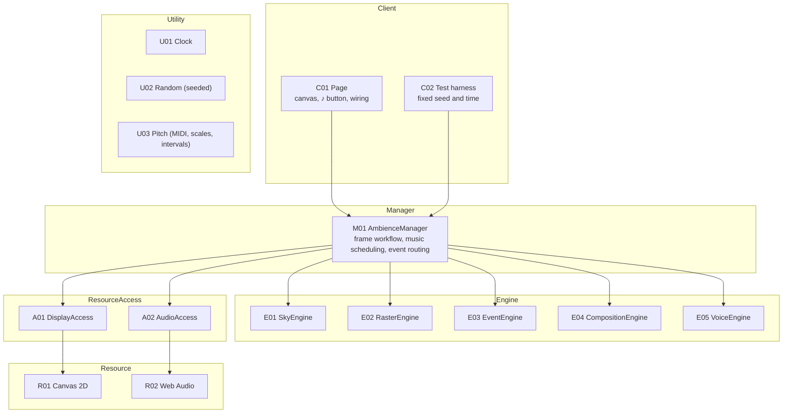

# 01 Overview design: decomposition by volatility (The Method)

Requirements: [00-requirements.md](00-requirements.md). Details of each component: [02-detailed-design.md](02-detailed-design.md).

## 1. Scope
A single static page. It draws a slowly turning ASCII galaxy on a white monospace grid and, after the "♪" button is pressed, plays chill music composed on the fly. There are no settings, no accounts, and nothing is saved.

## 2. What does not change (the core)
These are fixed as rules, not treated as volatility.

| Rule | Content |
|---|---|
| The cell grid | The screen is a grid of monospace cells. Each cell shows at most one glyph on a filled background |
| Brightness → cell | What is drawn is decided only by a brightness value in [0, 1] per cell plus a colour tag |
| Pitch | 12-tone equal temperament, A4 = 440 Hz. Notes are MIDI numbers |
| Time in music | Music time is counted in bars and 16th-note steps in 4/4. Wall-clock time is derived from the tempo |

## 3. Volatility analysis
| ID | Volatility | How it may change | Axis | Encapsulated in |
|---|---|---|---|---|
| VOL-01 | What is in the sky | One spiral → several galaxies → an interacting pair. Star count, tilt, size | Time | E01 SkyEngine |
| VOL-02 | How brightness becomes glyphs | Glyph ramp, colours, white or black paper, cell size | Time | E02 RasterEngine |
| VOL-03 | Rare events | A star brightening → shooting stars, comets. Frequency | Time | E03 EventEngine |
| VOL-04 | Composition rules (style) | Chill → ambient → jazzier. Progressions, voicing, rhythm, melody rules | Time | E04 CompositionEngine (pure functions; a style is swappable data) |
| VOL-05 | Timbre | FM electric piano → other synthesis → recorded samples | Time | E05 VoiceEngine (describes patches as data) |
| VOL-06 | Where the picture goes | Canvas 2D → WebGL → terminal → video export | Time | A01 DisplayAccess |
| VOL-07 | Where the sound goes | Real-time AudioContext → OfflineAudioContext for tests and export | Use (test vs. live) | A02 AudioAccess |
| VOL-08 | How time advances | Real time, a single still frame (reduced motion), paused off-screen, fixed time in tests | Use | U01 Clock (pure; C01 feeds it frame times and visibility) |
| VOL-09 | How picture and sound are tied | Only the chime → chords following the rotation, and so on | Time | M01 AmbienceManager |

## 4. Not treated as volatility
| Candidate | Reason |
|---|---|
| User settings (volume slider, style picker) | R-11 allows only the "♪" button. Revisit as a new Client if needed |
| Playing existing audio files | Excluded by the premises (no existing music) |
| Saving state between visits | Nothing is worth keeping; each visit starts fresh |
| Camera movement | Excluded by the premises (fixed view) |

## 5. Layers

- Engines never call each other. M01 passes the output of one Engine to the next.
- Engines are pure: they take state, time, and a random source, and return data (a brightness field, cells, events, notes, patches).
- Browser APIs are used only by C01 (DOM, the "♪" button, requestAnimationFrame, IntersectionObserver, matchMedia) and by A01 and A02 (Canvas 2D, Web Audio). M01, the Engines, and the Utilities never touch them. C02 can therefore test M01, every Engine, and every Utility without a browser; only tests that go through A01 or A02 (UC-05) need one.
- Utilities may be used from any layer.

## 6. Core use cases and call chains
| ID | Use case | Call chain |
|---|---|---|
| UC-01 | Open the page and watch: the galaxy turns, stars twinkle | C01 (requestAnimationFrame) → U01.advance(now) → M01.step(dt) → E03.update(t) → E01.field(t, flares) → E02.rasterize(field, t) → A01.draw(cells) → R01 |
| UC-02 | Press "♪": music starts and the layers change every 8 bars | C01 (button) → M01.startMusic() → A02.open() → R02. Each bar, ahead of time: M01 → E04.nextBar(state, rng from U02, pitches from U03) → notes → E05.patch(note, layer) → A02.schedule(patch, when) → R02 |
| UC-03 | A star brightens and a chime in the current key sounds | Inside UC-01, E03.update emits a Flare → M01 → E01.field(t, flares) → E02 → A01 → R01; and, once music has started, M01 → E04.chime(key) → E05.patch → A02.schedule → R02 |
| UC-04 | Reduced motion shows one still frame; off-screen stops | C01 (matchMedia or IntersectionObserver) → U01 mode still or paused. Still: M01.step once at a settled time → E03 → E01 → E02 → A01 → R01. Paused: M01 is not stepped |
| UC-05 | A test renders one minute of sound and checks the limits (R-13) | C02 → U01 mode fixed, U02 seeded → M01.startMusic() with A02 bound to an OfflineAudioContext (R02). For 60 s of bars: M01 → E04 → E05 → A02.schedule → R02 render → C02 measures the rendered buffer |

Where each component appears:

| Component | Use cases |
|---|---|
| C01 | UC-01, UC-02, UC-04 |
| C02 | UC-05 |
| M01 | UC-01–UC-05 |
| E01, E02, A01, R01 | UC-01, UC-03, UC-04 |
| E03 | UC-01, UC-03, UC-04 |
| E04, E05, A02, R02 | UC-02, UC-03, UC-05 |
| U01 | UC-01, UC-04, UC-05 |
| U02 | UC-02, UC-05 |
| U03 | UC-02 |

## 7. Requirements traceability
| Requirement | Where it is met | How it is checked (02 Verification) |
|---|---|---|
| R-01–R-04 | E01 | Screenshots (R-07 row) |
| R-05 | E03, E01 | Screenshots; E03 unit test on flare timing |
| R-06 | E02 | Screenshots |
| R-07 | E02 (cell size from screen width) | Screenshots at 1440 px and 390 px |
| R-08 | C01, U01 (UC-04) | U01 unit test on modes |
| R-10 | E04, M01 (bar scheduling) | Long-run generation test |
| R-11 | C01, A02 (UC-02) | Browser test: no AudioContext before the button is pressed |
| R-12 | E03 → M01 → E04.chime (UC-03) | E04 unit test: the chime pitch is in the current scale |
| R-13 | E05 (envelopes), A02 (master chain) | Patch unit test; rendered-loudness browser test |
| R-20 | Outside the runtime layers: `scripts/check-privacy.mjs`, run in CI and before each commit | CI step "Check privacy" |
| R-21 | Outside the runtime layers: `.github/workflows/`, `.github/dependabot.yml` | `check:workflows` (every `uses:` pinned to a 40-hex SHA), added with the Pages workflow in build step 5 |

## 8. Open questions
- OQ-01 Whether to show the page on the homepage's list of works.
